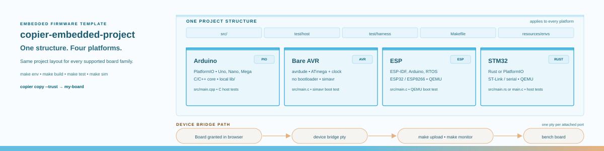

# copier-embedded-project

A Copier template that generates one embedded firmware project for Arduino, bare AVR, ESP or STM32.
The generated project carries its own conda environment installers, a self-documenting Makefile, host
unit tests, a simulator harness and optional folders chosen in one multiselect question.

## Quick start

```bash
copier copy --trust /path/to/copier-embedded-project my-board
cd my-board
make help
make env      # creates the conda environment with the toolchain
make build
```

## Questions

| Question | Meaning |
|---|---|
| `platform` | `arduino`, `avr`, `esp` or `stm32` |
| `arduino_board` | Uno, Nano, Mega 2560, Leonardo or another PlatformIO board id |
| `arduino_bootloader` | Nano only: `old` (57600 baud) or `new` (115200) |
| `arduino_libraries` | add `lib/` for project-local Arduino libraries |
| `avr_mcu`, `avr_clock`, `avr_programmer` | bare AVR chip, clock and upload programmer |
| `esp_chip`, `esp_framework`, `esp_board` | ESP32 or ESP8266; ESP-IDF, Arduino or the RTOS SDK |
| `stm32_toolchain` | `rust` or `platformio`; both use the one `firmware-stm32` environment |
| `stm32_board`, `stm32_framework`, `stm32_upload` | board family, STM32Cube or Arduino, ST-Link or serial |
| `components` | multi-select: `notebooks`, `resources`, `references`, `data`, `simulator`, `docs`, `ci`, `agents`, `env-installers`, `device-bridge`, `ltspice` |
| `open_source_license` | `Apache-2.0`, `MIT`, or no license file |
| `author_name` | a name, optionally with the email: `Konrad Jelen <konrad.jelen@gmail.com>` or `Konrad Jelen konrad.jelen@gmail.com` |

- The author answer is decomposed: name and email are separated for the LICENSE, so both forms give
  `Copyright (c) 2026 Konrad Jelen <konrad.jelen@gmail.com>`

## What the generated project holds

- `resources/envs/` - the lab conda installers; `make create_environment` runs the platform's
  installer
- `src/` - starter firmware for the platform, with the boot line; the pure logic is in a shared
  module
- `test/host/` - host unit tests of the shared module: C for PlatformIO branches, a Rust crate for
  STM32 Rust
- `test/harness/` and `test/functional/` - simavr for AVR, QEMU for ESP and STM32, skipped with a
  reason when the emulator is not installed
- `Makefile` - every development command; `make help` lists the targets
- Component folders, present only when selected: `notebooks/`, `resources/`, `references/`,
  `docs/`, `.github/workflows/`, `.agents/` with `.claude/` links

## Agent folders

`.agents/` is the master for agent assets. In a generated project that selects `agents`:

- `.agents/skills/<project>-device/SKILL.md` - build, upload, console and safety facts
- `.agents/skills/<project>-toolchain/SKILL.md` - the conda environment, the simulators and LTspice
- `.agents/workflows/` - command files
- `.claude/skills/<project>-device` and `.claude/skills/<project>-toolchain` - relative symlinks
  into `.agents/skills`
- `.claude/commands` - a relative symlink to `.agents/workflows`

## Testing the template

```bash
make setup
make test              # renders the platform and component matrix, fast checks
make test-toolchain    # additionally builds the AVR branches with firmware-avr
```

The tests render projects into temporary directories with `copier copy --trust --defaults`.

- **Files** - exact file sets, no Jinja delimiters, executable installer copies
- **Commands and components** - the `make help` output and the effect of each component selection
- **Toolchain** - builds an Arduino and a bare AVR project and runs the simavr boot test; skips
  when the `firmware-avr` conda environment is absent

## Developing the template

`make setup` creates `.venv` from `pyproject.toml`; every later command runs in it.

- Edit the generated project in `template/`; every file there is a Jinja template, with no suffix
- `envs/` is the master for the firmware environment definitions and installers; `~/.local/lab-utils/envs` symlinks to it
- `make envs-sync` copies the four installer files into `template/resources/envs/`
- Questions and derived answers live in `copier.yml`
- File removal, component selection, agent symlinks and git init live in `scripts/post_gen.py`
- `make test` is the gate: it renders the platform and component matrix and runs the fast checks
- `make test-toolchain` also builds the AVR branches when the `firmware-avr` conda environment exists
- `make lint` runs ruff over `scripts/` and `tests/`
- Render a scratch project with `copier copy --trust . tmp/scratch`, then `cd tmp/scratch && make help`
- Acceptance criteria and defects live in `docs/` and are written only through `pm-tools`
- Lessons from a real board project are in `docs/lessons-audio-detector.md`

## Limits

- Every platform branch is built on this workstation: Arduino, bare AVR in C, C++ and Rust, ESP32
  with ESP-IDF, ESP8266 with Arduino, STM32 Rust and STM32 with PlatformIO and STM32Cube
- The simulator tier runs where an emulator exists: simavr for AVR, the `netduinoplus2` machine of
  `qemu-system-arm` for STM32 f405rg, and Espressif's QEMU fork for ESP32 with Arduino or ESP-IDF
- The installers carry QEMU and ngspice; simavr comes from the PlatformIO package
- ESP8266 has no machine and stays HIL only
- `firmware-stm32` carries both STM32 toolchains, Rust and PlatformIO, so a project uses one
  environment whichever toolchain it names
- `ststm32@20.0.0` and the platform versions are pinned in `copier.yml` and in the installers; keep
  the two in step

## Layout of this repository

```
copier.yml                     questions, derived answers, post-generation task
scripts/post_gen.py            file selection, component removal, agent symlinks, git init
envs/                          master environment definitions and installers
                               ~/.local/lab-utils/envs symlinks here; make envs-sync copies them to the template
template/                      the rendered project
├── Makefile                   create_environment, build, upload, monitor, test, sim, ltspice, clean
├── src/                       adapters: main.c, main.cpp, <repo>.ino; src/bin/<repo>.rs in Cargo projects
├── lib/                       lib/core for C and C++, the library register, lib/vendor for Arduino
├── test/                      test/host, test/harness, test/functional
├── tools/                     eeprom_tool.py and, for STM32Cube, freertos.py
├── resources/                 README, graphics/, external/, envs/ installers, eeprom/ images
├── references/                datasheets/, notes/, schematics/ for the PCB schematic and board files
├── ltspice/                   opt-in circuit netlist, runner and functional test
├── notebooks/, data/, docs/   opt-in components
├── .agents/                   device skill and workflow; .claude/ holds the links
└── .github/                   opt-in CI workflow
tests/                         pytest suite of the template
docs/                          design, acceptance criteria, defects, best practices, lessons
.agents/                       the template's own agent skill and workflows
```

The generated project's own README repeats this tree with the variations of its toolchain and a
table saying where schematics, resources and libraries belong.
